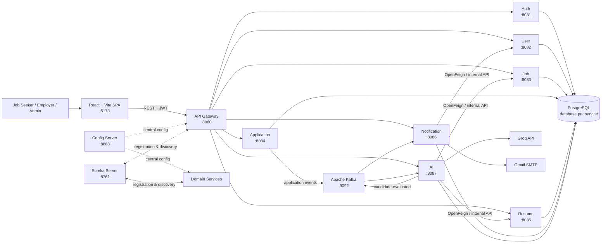
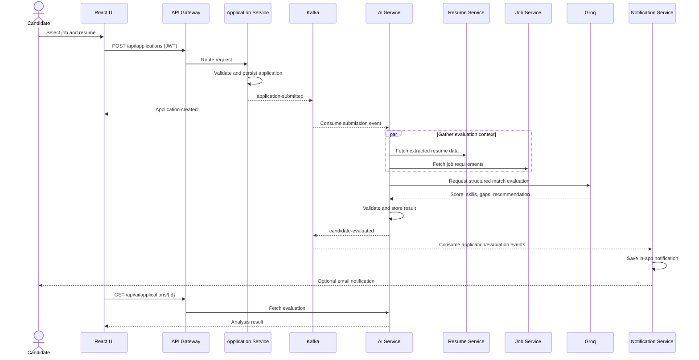
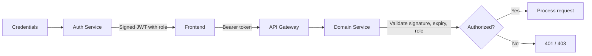

<div align="center">
  
  <h1>SmartJob — AI-Powered Job Portal</h1>
  <p>
    A role-based recruitment platform built with React and Spring Boot microservices,<br />
    featuring AI-assisted candidate evaluation, event-driven notifications, and resume analysis.
  </p>

  [](https://openjdk.org/projects/jdk/21/)
  [](https://spring.io/projects/spring-boot)
  [](https://react.dev/)
  [](https://www.postgresql.org/)
  [](https://kafka.apache.org/)
  [](https://www.docker.com/)
</div>

---

## Overview

SmartJob connects job seekers, employers, and administrators through one responsive web application. The backend is split into independently focused services discovered through Eureka, configured centrally through Spring Cloud Config, and exposed through a single API Gateway. Applications trigger Kafka events that power AI evaluation and in-app/email notifications without blocking the primary request.

## Key Features

### Job seekers

- Browse and filter jobs without signing in.
- Maintain a personal profile and upload PDF or DOC/DOCX resumes (up to 5 MB).
- Apply for jobs and track each application's status.
- View AI-generated match scores, skill gaps, strengths, and recommendations.
- Receive application and evaluation notifications.

### Employers

- Create, update, publish, close, and delete job listings.
- Review applications and candidate profiles.
- Inspect resume-based AI evaluations and candidate rankings.
- Move candidates through the recruitment lifecycle.

### Administrators

- Monitor platform-level users, jobs, and applications.
- Access protected administrative dashboards and operations.

### Platform capabilities

- JWT authentication with `JOB_SEEKER`, `EMPLOYER`, and `ADMIN` authorization.
- Service discovery, client-side load balancing, and centralized configuration.
- Kafka-based asynchronous processing for submissions, status changes, and AI results.
- Groq OpenAI-compatible API integration for structured candidate evaluation.
- PostgreSQL database-per-service isolation.
- Gmail SMTP support for outbound email notifications.
- Health/diagnostic endpoints through Spring Boot Actuator.

## Technology Stack

<div align="center">
  
</div>

| Layer | Technologies |
|---|---|
| Frontend | React 18, Vite 5, React Router, Redux Toolkit, Axios, Tailwind CSS, Lucide React |
| Backend | Java 21, Spring Boot 4.1.1, Spring MVC/WebFlux, Spring Security, Spring Data JPA |
| Cloud | Spring Cloud Config, Netflix Eureka, Spring Cloud Gateway, OpenFeign, LoadBalancer |
| Messaging | Apache Kafka, Spring Kafka |
| Data | PostgreSQL 17, Hibernate/JPA |
| AI | Groq Chat Completions API (`openai/gpt-oss-20b` by default) |
| Documents | Apache PDFBox and Apache POI |
| Security | JWT (`jjwt`), role-based access control, internal service key |
| DevOps | Docker, Docker Compose, Maven Wrapper, GitHub Actions |

## System Architecture



### Service catalogue

| Service | Port | Responsibility | Database |
|---|---:|---|---|
| API Gateway | 8080 | Public entry point, routing, CORS, load-balanced service access | — |
| Auth Service | 8081 | Registration, login, password hashing, JWT issuance | `auth_db` |
| User Service | 8082 | Candidate/employer profiles and internal user lookup | `user_db` |
| Job Service | 8083 | Job lifecycle, search, employer listings | `job_db` |
| Application Service | 8084 | Job applications, status tracking, Kafka event production | `application_db` |
| Resume Service | 8085 | Resume upload/storage and PDF/DOC/DOCX text extraction | `resume_db` |
| Notification Service | 8086 | In-app notifications, event consumption, email delivery | `notification_db` |
| AI Service | 8087 | Resume/job matching, structured scoring, Groq integration | `ai_db` |
| Config Server | 8888 | Native centralized configuration for every service | — |
| Eureka Server | 8761 | Service registration and discovery dashboard | — |

## Application Workflow



Kafka topics used by the platform:

- `application-submitted` — starts AI evaluation and submission notifications.
- `application-status-changed` — informs candidates about recruitment progress.
- `candidate-evaluated` — announces completion of the AI assessment.

## Project Structure

```text
AI-Job-Portal/
├── frontend/                 React/Vite single-page application
├── api-gateway/              External API entry point
├── config-server/            Central configuration repository
├── eureka-server/            Service registry
├── auth-service/             Identity and JWT authentication
├── user-service/             User profiles
├── job-service/              Job catalogue and management
├── application-service/      Applications and workflow events
├── resume-service/           Uploads and text extraction
├── ai-service/               AI candidate evaluation
├── notification-service/     In-app and email notifications
├── docker/postgres/init.sql  Database bootstrap script
├── docker-compose.yml        PostgreSQL and Kafka infrastructure
├── docker-compose.full.yml   Container definitions for all services
└── .github/workflows/        Backend CI matrix
```

## Getting Started

### Prerequisites

- Java 21+
- Maven 3.9+ (or the included Maven wrapper in each service)
- Node.js 20+ and npm
- Docker Desktop with Docker Compose
- A Groq API key for live AI evaluations
- Optional: Gmail account with an App Password for email delivery

### 1. Clone and configure

```bash
git clone https://github.com/kirusigan03/AI_Job_Portal.git
cd AI_Job_Portal
cd AI-Job-Portal
cp .env.example .env
```

On PowerShell, use `Copy-Item .env.example .env`. Then replace every placeholder in `.env`:

```dotenv
DB_PASSWORD=your_local_postgres_password
JWT_SECRET=use_a_long_random_signing_secret
INTERNAL_SERVICE_KEY=use_a_separate_random_service_secret
GROQ_API_KEY=your_groq_api_key
GROQ_MODEL=openai/gpt-oss-20b
MAIL_USERNAME=your_email@gmail.com
MAIL_PASSWORD=your_gmail_app_password
```

> Never commit `.env`, production credentials, uploaded resumes, or real candidate data.

### 2. Start infrastructure

```bash
docker compose up -d
docker compose ps
```

This starts PostgreSQL on `5432`, creates the seven service databases on the first run, and starts Kafka on `9092`.

### 3. Start the backend

Start the services in the following order, using a separate terminal for each command:

```bash
cd config-server && ./mvnw spring-boot:run
cd eureka-server && ./mvnw spring-boot:run
cd auth-service && ./mvnw spring-boot:run
cd user-service && ./mvnw spring-boot:run
cd job-service && ./mvnw spring-boot:run
cd application-service && ./mvnw spring-boot:run
cd resume-service && ./mvnw spring-boot:run
cd notification-service && ./mvnw spring-boot:run
cd ai-service && ./mvnw spring-boot:run
cd api-gateway && ./mvnw spring-boot:run
```

On Windows, replace `./mvnw` with `.\mvnw.cmd`. Wait for Config Server and Eureka to become available before starting the remaining services.

### 4. Start the frontend

```bash
cd frontend
npm install
npm run dev
```

Open [http://localhost:5173](http://localhost:5173). API requests are sent through the gateway at [http://localhost:8080](http://localhost:8080), and the Eureka dashboard is available at [http://localhost:8761](http://localhost:8761).

### Full container build

`docker-compose.full.yml` defines the application containers. Build each JAR before starting it:

```bash
./mvnw -f auth-service/pom.xml clean package -DskipTests
# Repeat for every backend service, then:
docker compose -f docker-compose.yml -f docker-compose.full.yml up --build
```

> The checked-in centralized configuration currently uses `localhost` addresses for developer-mode execution. For an all-container deployment, provide a container profile/override that uses Compose DNS names such as `postgres`, `kafka`, `config-server`, and `eureka-server`.

## API Overview

All browser-facing requests should use the gateway base URL: `http://localhost:8080`.

| Area | Base path | Representative operations |
|---|---|---|
| Authentication | `/api/auth` | Register, login |
| Users | `/api/users` | Create/read/update/delete profiles, admin user listing |
| Jobs | `/api/jobs` | Browse, search, create, update status, delete |
| Applications | `/api/applications` | Apply, view candidate/job applications, update status |
| Resumes | `/api/resumes` | Upload, list, retrieve, delete |
| AI analysis | `/api/ai` | Fetch analysis by application or resume |
| Notifications | `/api/notifications` | List user notifications, mark as read |

Protected endpoints expect:

```http
Authorization: Bearer <jwt-token>
```

Internal `/internal/**` endpoints are intended for service-to-service calls and use the shared internal service key rather than public routing.

## Security Model



- Passwords are handled by Spring Security and are not returned by APIs.
- JWT signing uses `JWT_SECRET`; use a long, random value and rotate it securely.
- UI route guards improve navigation, while backend authorization remains the security boundary.
- Service-only data access uses `INTERNAL_SERVICE_KEY` and should not be exposed publicly.
- Resume uploads are size-limited and restricted to supported document types.

## Quality Checks

Run frontend checks:

```bash
cd frontend
npm run lint
npm run build
```

Run a backend service's test suite:

```bash
cd ai-service
./mvnw clean verify
```

GitHub Actions runs `mvn clean verify` across all ten backend/configuration modules on pushes and pull requests targeting `main` or `develop`.

## Troubleshooting

| Symptom | Check |
|---|---|
| Service cannot load configuration | Confirm Config Server is healthy at `http://localhost:8888/{service-name}/default`. |
| Gateway returns `503` | Confirm the target service appears in Eureka and its configured port is free. |
| Database connection fails | Verify Docker is running, `.env` contains the correct password, and the Postgres volume was initialized. |
| Kafka events are not processed | Verify the broker on `9092`, topic names, and consumer logs in AI/Notification services. |
| AI result is missing | Verify `GROQ_API_KEY`, the configured model, resume text extraction, and AI service logs. |
| Email is not sent | Use a Gmail App Password and verify `MAIL_USERNAME`/`MAIL_PASSWORD`; in-app notifications can still work independently. |
| Resume upload fails | Use PDF, DOC, or DOCX and keep the file below 5 MB. |

## Contributing

1. Create a feature branch from `develop`.
2. Keep changes focused within the relevant service or frontend feature.
3. Add or update tests and run the quality checks above.
4. Never include secrets, build output, IDE state, or candidate documents.
5. Open a pull request describing behavior changes and verification performed.

---

<div align="center">
  Built as a scalable, event-driven recruitment platform with AI-assisted decision support.
</div>
