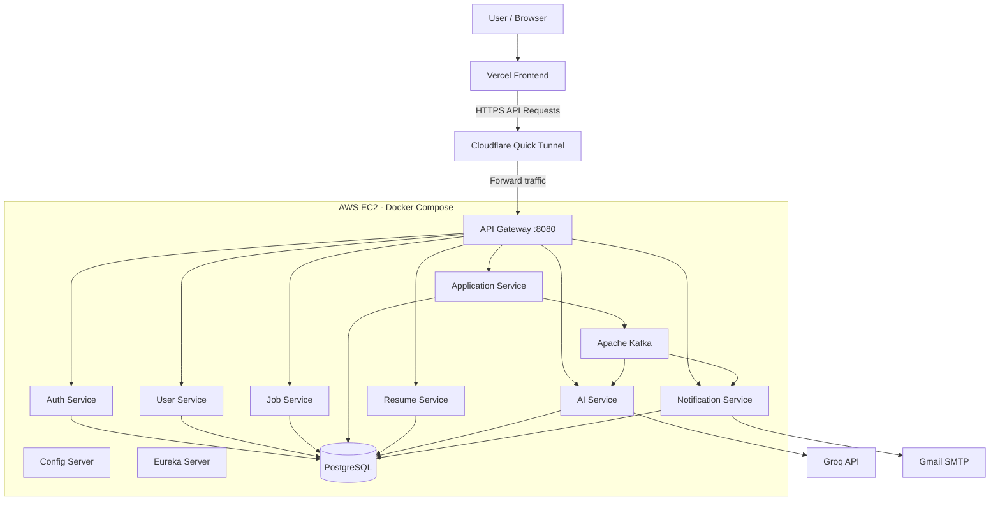
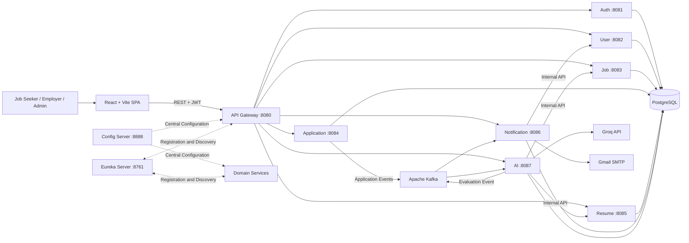
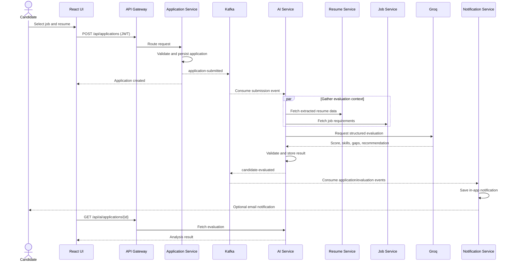
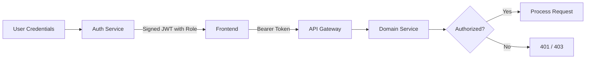

 <div align="center">
  

  # SmartJob — AI-Powered Job Portal

  A role-based recruitment platform built with React and Spring Boot microservices, featuring AI-assisted candidate evaluation, event-driven notifications, and resume analysis.

  [](https://openjdk.org/projects/jdk/21/)
  [](https://spring.io/projects/spring-boot)
  [](https://react.dev/)
  [](https://www.postgresql.org/)
  [](https://kafka.apache.org/)
  [](https://www.docker.com/)
</div>

---

## Table of Contents

- [Overview](#overview)
- [Live Deployment](#live-deployment)
- [Key Features](#key-features)
- [Technology Stack](#technology-stack)
- [System Architecture](#system-architecture)
- [Service Catalogue](#service-catalogue)
- [Application Workflow](#application-workflow)
- [Project Structure](#project-structure)
- [Getting Started](#getting-started)
- [API Overview](#api-overview)
- [Security Model](#security-model)
- [Quality Checks](#quality-checks)
- [Troubleshooting](#troubleshooting)
- [Contributing](#contributing)

## Overview

SmartJob connects job seekers, employers, and administrators through a responsive web application.

The backend is split into independently focused microservices discovered through Eureka, configured centrally through Spring Cloud Config, and exposed through a single API Gateway.

Applications trigger Kafka events that power AI evaluation and in-app/email notifications without blocking the primary request.

### Project Highlights

- Role-based recruitment platform for job seekers, employers, and administrators.
- Spring Boot microservices with centralized configuration and service discovery.
- AI-assisted candidate evaluation using resume and job-description analysis.
- Event-driven communication using Apache Kafka.
- JWT authentication and role-based authorization.
- PostgreSQL database-per-service isolation.
- Docker Compose-based deployment on AWS EC2.
- Vercel-hosted frontend with HTTPS API access through Cloudflare Quick Tunnel.

## Live Deployment

SmartJob is deployed using **Vercel for the frontend and AWS EC2 for the backend**. Cloudflare Quick Tunnel provides temporary HTTPS connectivity between the frontend and the API Gateway.

### Live Application

<details>
<summary><strong>Frontend — Vercel</strong></summary>

**Production URL:** https://ai-job-portal-kirusigan.vercel.app

The React and Vite frontend is deployed on Vercel.

Verified during deployment:

- Production build completed successfully.
- Frontend returned `200 OK`.
- User login worked with the deployed backend.
- Job API requests were successful.

</details>

<details>
<summary><strong>Backend — AWS EC2</strong></summary>

**Hosting platform:** AWS EC2  
**Region:** `ap-southeast-2` — Sydney  
**Operating system:** Amazon Linux  
**Containerization:** Docker and Docker Compose

The backend microservices and infrastructure run in Docker containers on EC2.

Services include:

- API Gateway
- Authentication Service
- User Service
- Job Service
- Application Service
- Resume Service
- AI Service
- Notification Service
- Config Server
- Eureka Server
- PostgreSQL
- Apache Kafka

</details>

### Deployment Architecture



### Backend HTTPS API

The API Gateway is accessible through a Cloudflare Quick Tunnel.

**Tunnel URL at the time of deployment:**

`https://ears-saturn-tourism-sur.trycloudflare.com`

Example jobs endpoint:

`https://ears-saturn-tourism-sur.trycloudflare.com/api/jobs`

The `/api/jobs` endpoint returned `200 OK` during verification. The response was an empty array (`[]`) because no jobs were present in the database at that time.

> **Important:** Cloudflare Quick Tunnel URLs are temporary. The URL above may no longer be active or may change when the tunnel is restarted.

### AWS Network Security

The deployment keeps internal infrastructure private.

| Component | Port | Exposure |
|---|---:|---|
| API Gateway | 8080 | Public application entry point |
| PostgreSQL | 5432 | Private Docker network |
| Apache Kafka | 9092 | Private Docker network |
| Config Server | 8888 | Private Docker network |
| Eureka Server | 8761 | Private Docker network |

Only the API Gateway port was verified as listening publicly on the EC2 host during the deployment checks.

PostgreSQL, Kafka, Config Server, and Eureka Server are not intended to be directly accessible from the public internet.

### Deployment Verification

The following checks were completed during deployment:

| Check | Result at verification time |
|---|---|
| Vercel frontend | `200 OK` |
| HTTPS API tunnel | Working |
| Jobs endpoint | `200 OK` |
| User login | Working |
| PostgreSQL | Healthy |
| Kafka | Running |
| Backend microservices | Running |
| Public application port | API Gateway only |

These results describe the deployment verification performed at that time and do not guarantee current uptime.

### Deployment Limitations

The current Cloudflare Quick Tunnel setup is suitable for development and demonstration purposes.

- The temporary tunnel URL can change when a new tunnel is started.
- API connectivity stops if the `cloudflared` process terminates.
- If the URL changes, update `VITE_API_BASE_URL` in Vercel and redeploy the frontend.
- A stable production deployment should use a custom domain and a persistent Cloudflare Tunnel configuration.
- Keep database credentials, JWT secrets, internal service keys, and API keys private.

## Key Features

### Job Seekers

- Browse and filter jobs without signing in.
- Maintain a personal profile.
- Upload PDF or DOC/DOCX resumes up to 5 MB.
- Apply for jobs and track application status.
- View AI-generated match scores, skill gaps, strengths, and recommendations.
- Receive application and evaluation notifications.

### Employers

- Create, update, publish, close, and delete job listings.
- Review applications and candidate profiles.
- Inspect resume-based AI evaluations and candidate rankings.
- Move candidates through the recruitment lifecycle.

### Administrators

- Monitor platform-level users, jobs, and applications.
- Access protected administrative dashboards and operations.

### Platform Capabilities

- JWT authentication with `JOB_SEEKER`, `EMPLOYER`, and `ADMIN` authorization.
- Service discovery and centralized configuration.
- Kafka-based asynchronous processing for submissions, status changes, and AI results.
- Groq API integration for structured candidate evaluation.
- PostgreSQL database-per-service isolation.
- Gmail SMTP support for outbound email notifications.
- Health and diagnostic endpoints through Spring Boot Actuator.

## Technology Stack

<div align="center">
  
</div>

| Layer | Technologies |
|---|---|
| Frontend | React 18, Vite 5, React Router, Redux Toolkit, Axios, Tailwind CSS, Lucide React |
| Backend | Java 21, Spring Boot 4.1.1, Spring MVC/WebFlux, Spring Security, Spring Data JPA |
| Cloud | Spring Cloud Config, Netflix Eureka, Spring Cloud Gateway, OpenFeign, LoadBalancer |
| Messaging | Apache Kafka, Spring Kafka |
| Data | PostgreSQL 17, Hibernate/JPA |
| AI | Groq Chat Completions API (`openai/gpt-oss-20b` by default) |
| Documents | Apache PDFBox, Apache POI |
| Security | JWT (`jjwt`), role-based access control, internal service key |
| DevOps | Docker, Docker Compose, Maven Wrapper, GitHub Actions |
| Hosting | Vercel, AWS EC2, Cloudflare Quick Tunnel |

## System Architecture



### Service Catalogue

| Service | Port | Responsibility | Database |
|---|---:|---|---|
| API Gateway | 8080 | Public entry point, routing, CORS, load-balanced access | — |
| Auth Service | 8081 | Registration, login, password hashing, JWT issuance | `auth_db` |
| User Service | 8082 | Candidate/employer profiles and internal user lookup | `user_db` |
| Job Service | 8083 | Job lifecycle, search, employer listings | `job_db` |
| Application Service | 8084 | Applications, status tracking, Kafka event production | `application_db` |
| Resume Service | 8085 | Resume uploads, storage, document text extraction | `resume_db` |
| Notification Service | 8086 | In-app notifications, event consumption, email delivery | `notification_db` |
| AI Service | 8087 | Resume/job matching, scoring, Groq integration | `ai_db` |
| Config Server | 8888 | Centralized configuration | — |
| Eureka Server | 8761 | Service registration and discovery | — |

## Application Workflow



### Kafka Topics

- `application-submitted` — starts AI evaluation and submission notifications.
- `application-status-changed` — informs candidates about recruitment progress.
- `candidate-evaluated` — announces completion of the AI assessment.

## Project Structure

```text
AI-Job-Portal/
├── frontend/                 React/Vite single-page application
├── api-gateway/              External API entry point
├── config-server/            Central configuration
├── eureka-server/            Service registry
├── auth-service/             Identity and JWT authentication
├── user-service/             User profiles
├── job-service/              Job catalogue and management
├── application-service/      Applications and workflow events
├── resume-service/           Uploads and text extraction
├── ai-service/               AI candidate evaluation
├── notification-service/     In-app and email notifications
├── docker/
│   └── postgres/
│       └── init.sql          Database bootstrap script
├── docker-compose.yml        PostgreSQL and Kafka infrastructure
├── docker-compose.full.yml   Application container definitions
├── .env.example              Environment variable template
└── .github/
    └── workflows/            Backend CI workflows
```

## Getting Started

### Prerequisites

- Java 21+
- Maven 3.9+ or the included Maven Wrapper
- Node.js 20+ and npm
- Docker Desktop with Docker Compose
- A Groq API key for live AI evaluations
- Optional: Gmail account with an App Password for email delivery

### 1. Clone the Repository

```bash
git clone https://github.com/kirusigan03/AI_Job_Portal.git
cd AI_Job_Portal
cd AI-Job-Portal
```

### 2. Configure Environment Variables

Copy the example environment file.

**Linux/macOS:**

```bash
cp .env.example .env
```

**Windows PowerShell:**

```powershell
Copy-Item .env.example .env
```

Configure the values in `.env` according to the settings required by your local environment.

```dotenv
DB_PASSWORD=your_local_postgres_password
JWT_SECRET=your_long_random_signing_secret
INTERNAL_SERVICE_KEY=your_separate_random_service_secret
GROQ_API_KEY=your_groq_api_key
GROQ_MODEL=openai/gpt-oss-20b
MAIL_USERNAME=your_email@gmail.com
MAIL_PASSWORD=your_gmail_app_password
```

Use the variable names and any additional required settings from the repository's `.env.example`.

> Never commit `.env`, production credentials, uploaded resumes, or real candidate data.

### 3. Start Infrastructure

```bash
docker compose up -d
docker compose ps
```

This starts PostgreSQL and Kafka as defined in the infrastructure Compose file.

The PostgreSQL initialization script creates the service databases on the first initialization, according to the configured setup.

### 4. Start the Backend

Start Config Server and Eureka Server first. Wait for them to become healthy before starting the remaining services.

Run each command from the project root in a separate terminal.

**Linux/macOS:**

```bash
cd config-server && ./mvnw spring-boot:run
```

```bash
cd eureka-server && ./mvnw spring-boot:run
```

```bash
cd auth-service && ./mvnw spring-boot:run
```

```bash
cd user-service && ./mvnw spring-boot:run
```

```bash
cd job-service && ./mvnw spring-boot:run
```

```bash
cd application-service && ./mvnw spring-boot:run
```

```bash
cd resume-service && ./mvnw spring-boot:run
```

```bash
cd notification-service && ./mvnw spring-boot:run
```

```bash
cd ai-service && ./mvnw spring-boot:run
```

```bash
cd api-gateway && ./mvnw spring-boot:run
```

Each command assumes it is executed from the project root. If you are already inside a service directory, run only that service's Maven Wrapper command.

**Windows:** use the corresponding `mvnw.cmd` wrapper in each service directory.

### 5. Start the Frontend

```bash
cd frontend
npm install
npm run dev
```

Open the application:

http://localhost:5173

The local API Gateway is expected at:

http://localhost:8080

The Eureka dashboard is expected at:

http://localhost:8761

These local URLs apply to a developer-mode setup with the relevant services running locally.

### Full Container Build

The `docker-compose.full.yml` file defines the application containers.

Build the backend JARs before starting the application containers. For example:

```bash
./mvnw -f auth-service/pom.xml clean package -DskipTests
```

Repeat for each backend service and configuration module that requires a JAR.

Then start the Compose configuration:

```bash
docker compose -f docker-compose.yml -f docker-compose.full.yml up --build
```

> The checked-in centralized configuration may use `localhost` addresses for developer-mode execution. For a fully containerized deployment, configure a container-specific profile or override using Compose DNS names such as `postgres`, `kafka`, `config-server`, and `eureka-server`, as appropriate to the service configuration.

## API Overview

All browser-facing API requests should use the API Gateway base URL.

**Local development:**

`http://localhost:8080`

**Deployed frontend:**

`https://ai-job-portal-kirusigan.vercel.app`

The deployed frontend uses the configured `VITE_API_BASE_URL` to reach the backend.

| Area | Base Path | Representative Operations |
|---|---|---|
| Authentication | `/api/auth` | Register, login |
| Users | `/api/users` | Create/read/update/delete profiles, admin user listing |
| Jobs | `/api/jobs` | Browse, search, create, update status, delete |
| Applications | `/api/applications` | Apply, view applications, update status |
| Resumes | `/api/resumes` | Upload, list, retrieve, delete |
| AI Analysis | `/api/ai` | Fetch analysis by application or resume |
| Notifications | `/api/notifications` | List notifications, mark as read |

Protected endpoints expect a JWT bearer token.

```http
Authorization: Bearer <jwt-token>
```

Internal `/internal/**` endpoints are intended for service-to-service communication and should use the configured internal service authentication mechanism rather than public routing.

## Security Model



### Security Features

- Passwords are handled using Spring Security and are not returned by APIs.
- JWT signing uses the configured `JWT_SECRET`.
- Role-based access control distinguishes `JOB_SEEKER`, `EMPLOYER`, and `ADMIN`.
- Frontend route guards improve navigation but are not a replacement for backend authorization.
- Service-to-service requests use the configured internal service key.
- Resume uploads are size-limited and restricted to supported document formats.
- PostgreSQL and Kafka should remain on private networks.
- Production deployments should use HTTPS, strong secrets, restricted security-group rules, and appropriate log and data-retention policies.

## Quality Checks

### Frontend

```bash
cd frontend
npm run lint
npm run build
```

### Backend

Run the test suite for an individual service.

```bash
cd ai-service
./mvnw clean verify
```

Repeat for other services as needed.

GitHub Actions is configured to run backend verification across the relevant modules on pushes and pull requests targeting `main` or `develop`, according to the repository workflow configuration.

## Troubleshooting

| Symptom | What to Check |
|---|---|
| Service cannot load configuration | Confirm Config Server is healthy and the service configuration is available. |
| Gateway returns `503` | Confirm the target service is running, registered in Eureka, and listening on the configured port. |
| Database connection fails | Verify Docker is running, `.env` has the correct password, and PostgreSQL initialization completed. |
| Kafka events are not processed | Verify the broker, topic names, and AI/Notification consumer logs. |
| AI result is missing | Verify `GROQ_API_KEY`, the configured model, resume text extraction, and AI service logs. |
| Email is not sent | Verify Gmail App Password and mail configuration. In-app notifications may still work independently. |
| Resume upload fails | Use a supported PDF, DOC, or DOCX file within the configured 5 MB limit. |
| Deployed frontend cannot reach the backend | Verify `VITE_API_BASE_URL`, tunnel availability, CORS configuration, and API Gateway logs. |
| Cloudflare tunnel URL no longer works | Check whether the Quick Tunnel process is running and whether the URL has changed. Update Vercel configuration if necessary. |
| Login fails after deployment | Check the authentication service, backend logs, API URL, JWT configuration, and browser network errors. |

## Contributing

1. Create a feature branch from `develop`.
2. Keep changes focused within the relevant service or frontend feature.
3. Add or update tests and run the appropriate quality checks.
4. Never include secrets, build output, IDE state, or candidate documents.
5. Open a pull request describing behavior changes and verification performed.

---

<div align="center">

Built as a scalable, event-driven recruitment platform with AI-assisted decision support.

**Frontend:** [Vercel](https://ai-job-portal-kirusigan.vercel.app)

</div>
